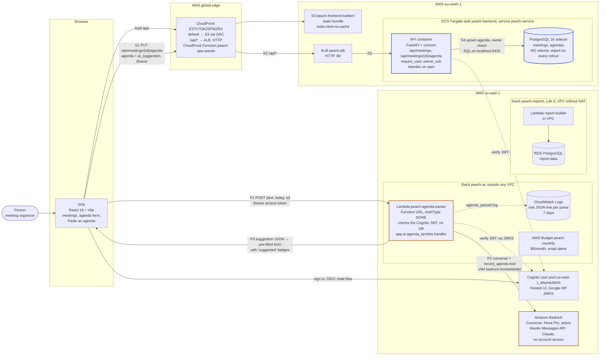

# Spry: C4 container diagram (as deployed, 2026-10-29)

Level 2 (containers) of the **real** deployment, following `CLAUDE.md` → "Deployed reality".
Arrows **P1–P3** form the **parse** path (the model only suggests); **S1–S4** form the **save**
path (only a person's Save writes).

## Notes

- **The parse path never touches a database.** The Lambda has no VPC config and no DB
  credentials, and its handler cannot import `app.db` (enforced by a test). Its IAM role allows
  Bedrock inference and its own log group only.
- **The save path is the only writer.** A person's Save goes through the regular validated API,
  which also stores `ai_suggestion`, `ai_model` and `ai_prompt_version` for later v1/v2 comparisons.
- **Regions:** the API and its data are in **eu-north-1**. Cognito, the parser, Bedrock and the
  Lab 5 reports are in **us-east-1**. The browser calls the parser's Function URL directly
  (cross-origin, CORS allows the CloudFront origin only), and calls the API same-origin through CloudFront.
- **The parser is outside the VPC on purpose.** The reports VPC has no NAT, so reaching Bedrock or Cognito
  from inside it would need interface endpoints at $7.30/month per AZ. See
  [ADR 0006](../adr/0006-llm-agenda-parsing.md).
- **Model switch:** the CloudFormation parameter `ParserModel`. `anthropic.*` goes through Mantle,
  anything else through Converse. The deployed value is `us.amazon.nova-pro-v1:0`.
- **Known risk:** the PostgreSQL sidecar has no volume. Every ECS rollout or task restart erases
  all meetings and agendas.
