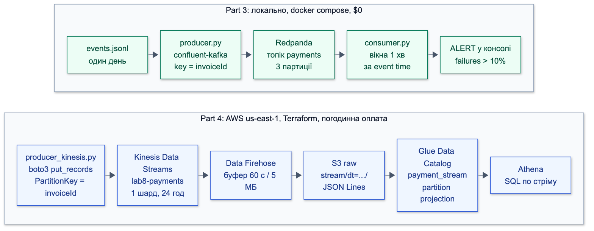

# Lab 8: відповіді

Умова: [TASK.md](TASK.md). Дані: [lab8/athena/](../../lab8/athena/) (SQL і `results/`),
[lab8/streaming/](../../lab8/streaming/), [lab8/cloud/](../../lab8/cloud/). Регіон: `us-east-1`.

## Part 1. Архітектура Uklon

### 1. Відставання real-time дороги на 10 хвилин і batch на добу

**Коротко.** Відставання real-time коштує грошей одразу, бо рішення приймаються на застарілих даних. Відставання batch
клієнт не помічає, і воно лікується повторним запуском.

Масштаб 10 хвилин: це 200 пропущених пінгів на водія (600 с / 3 с), авто на 30 км/год проїжджає 5 км,
а в черзі стоїть ~4 млн подій (6 713/с × 600 с).

| Що | Real-time −10 хв | Batch −1 доба |
|---|---|---|
| Matching | Redis тримає позиції 10-хвилинної давнини: призначає далекого водія або того, хто вже зайнятий; подача довша, більше скасувань | не зачіпає |
| Surge | коефіцієнт із DynamoDB застарів: у дощ ціна низька і водіїв бракує, після піку ціна висока і замовлення губляться | не зачіпає |
| ETA | модель працює, але на старих позиціях і заторах, тож обіцянка пасажиру неправдива; машина на карті стоїть | модель лишається вчорашньою, точність майже не падає |
| Звіти | не зачіпає | дашборди в Quick на добу старіші, менеджери рішень на них не приймають |
| ML | не зачіпає | навчання стартує на даних без останньої доби або чекає; за один день це непомітно |

Замовлення й оплата при цьому працюють: ECS і Aurora не залежать від Flink. Дані теж не зникають: Kinesis зберігає лог,
Firehose читає його окремо від Flink, тож data lake наповнюється далі.

**Як відновлюватись.** Real-time: для позицій беремо лише останній пінг водія, бо старі не мають цінності; записи в Redis
живуть із TTL, а surge за застарілих даних падає до безпечного значення. Batch: запускаємо нічний Glue job повторно по сирих
даних у S3.

**Де межа.** Доба відставання безпечна, поки відстає Glue, а не Firehose. Стандартне зберігання в Kinesis становить
24 години, тож зупинка Firehose на такий самий час уже означає втрату сирих подій.

### 2. Чому GPS не йде через Lambda

**Навантаження.** 580 млн пінгів на добу / 86 400 с ≈ **6 713 пінгів/с** у середньому, у піки більше.
На місяць: 580 млн × 30 = **17.4 млрд**.

**Вартість на місяць (17.4 млрд = 17 400 млн).** Ціни з AWS Price List, `us-east-1`, жовтень 2026, без free tier.
Припущення: Lambda x86, 128 МБ, 50 мс на виклик.

| Сервіс | Арифметика | $/міс |
|---|---|---|
| Lambda, запити | 17 400 млн × $0.20/млн | 3 480 |
| Lambda, час | 17.4 млрд × 0.05 с × 0.125 ГБ = 108.75 млн ГБ·с × $0.0000166667 | 1 813 |
| **Lambda разом** | | **≈ 5 290** |
| API Gateway REST | 333 × $3.50 + 667 × $2.80 + 16 400 × $2.38 = 1 166 + 1 868 + 39 032 | **≈ 42 070** |
| API Gateway HTTP API | 300 × $1.00 + 17 100 × $0.90 = 300 + 15 390 | **≈ 15 690** |
| IoT Core, повідомлення | 1 000 × $1.00 + 4 000 × $0.80 + 12 400 × $0.70 = 1 000 + 3 200 + 8 680 | 12 880 |
| IoT Core, з'єднання | ~20 тис. водіїв онлайн × 43 200 хв = 870 млн хв × $0.08/млн | 70 |
| IoT Core, правило і дія | 17 400 млн × ($0.15 + $0.15)/млн | 5 220 |
| **IoT Core разом** | | **≈ 18 170** |

20 тис. водіїв: 580 млн / 28 800 пінгів на добу від одного водія (86 400 с / 3 с).
Kinesis потрібен в обох варіантах, тому його не рахуємо.

**Висновок щодо ціни.** REST + Lambda ≈ **$47 тис./міс**, HTTP API + Lambda ≈ **$21 тис./міс**, IoT Core ≈ **$18 тис./міс**.
Проти REST виграш очевидний, проти HTTP API невеликий. Велика економія з'являється з Basic Ingest: повідомлення йдуть
напряму в правило без оплати за messaging, і лишається ~$5.3 тис./міс (70 + 5 220). Тож ціна важлива, але вирішують
і технічні причини нижче.

**Технічні причини:**

- **Постійне з'єднання.** Lambda не має стану і не тримає з'єднання. HTTP кожні 3 с несе заголовки на кожен запит, а на
  поганій мобільній мережі ще й нові TCP і TLS handshake. MQTT відкривається один раз, його фіксований заголовок має 2 байти:
  менше трафіку й витрат батареї. Цим самим з'єднанням можна слати дані водієві, а last will повідомляє про обрив.
- **Порядок подій.** Паралельні виклики Lambda порядку не гарантують: пінг із секунди 6 може обігнати пінг із секунди 3.
  У Kinesis із ключем `driverId` усі пінги водія йдуть в один шард і читаються по порядку.
- **Паралельність.** 6 713/с × 0.05 с ≈ 336 одночасних виконань у середньому, а за 150 мс уже ~1 000, тобто стандартна квота
  акаунта. Будь-яке уповільнення залежності впирається в throttling.
- **Cold start.** За постійного навантаження середовища теплі, тож це не головна причина. Він б'є під час піків і деплоїв:
  сотні мілісекунд на нових середовищах, а це хвіст затримки в дорозі, що має відповідати за секунди.

**Де Lambda доречна.** Не на кожен пінг, а на пачку: споживач Kinesis із batch 100 дає 174 млн викликів, тобто ~$35/міс за запити.
Саме так Lambda працює і в схемі Uklon: на новий файл у S3, а не на кожну подію.

### 3. Що стартап викине першим і що втратить

Лишаються ALB, ECS, одна БД (RDS замість Aurora) і S3. Решта викидається приблизно в такому порядку:

| Порядок | Викидаємо | Чим замінити | Що втрачаємо |
|---|---|---|---|
| 1 | SageMaker | ETA з routing API (OSRM, Google) × коефіцієнт години доби | точність ETA і прогноз попиту; даних на навчання все одно ще мало |
| 2 | Flink | cron щохвилини: SQL «замовлення / вільні водії» по районах | вікна event time, стан, реакцію за секунди; surge стає грубшим |
| 3 | DMS | нічний експорт із read replica у S3 | зміни майже в реальному часі та проміжні стани рядків |
| 4 | Glue job | Athena CTAS за розкладом, схема вручну (як у Part 2) | Spark для важких трансформацій; Data Catalog лишається, ним користується Athena |
| 5 | IoT Core | HTTP POST на ECS кожні 5–10 с, позиції в Redis | економію батареї й трафіку, зворотний канал до водія, last will |

Заміна IoT Core працює завдяки масштабу: 500 водіїв із пінгом раз на 5 с дають 100 запитів/с, і це витримує той самий ALB.
Без Flink і DMS зникає й потреба в Kinesis, тому стартап позбувається ще й постійної плати за стрім.

Спільна втрата: стартап міняє запас масштабу на простоту. Це вигідно, доки навантаження мале, але зворотний перехід потім
коштує міграції, найперше мобільного клієнта на MQTT.

## Part 2. Batch

### Масштаб

| Показник | Значення |
|---|---|
| Подій у `payment_events` | 3 030 197 |
| Унікальних `invoiceId` | 1 000 000 |
| Точних дублікатів | 30 197 (1.0% подій) |
| Частка подій із запізненням понад годину | **0%** (0 подій, максимум 600 с) |

Без дублікатів лишається рівно 3 000 000 подій, тобто по 3 на платіж. Запізнення понад годину немає, бо генератор затримує
події на 1–10 хв. Дані: [07_scale.csv](../../lab8/athena/results/07_scale.csv).

`dt` це день `modifiedDate`. Тому `dt=2026-10-31` містить лише 5 подій: це хвіст платежів, створених 30 жовтня наприкінці доби.
Фактично датасет покриває 30 днів.

### Результати запитів 2–6

Повні результати: [lab8/athena/results/](../../lab8/athena/results/).

**Запит 2. View `payments`:** 1 000 000 рядків, по одному на `invoiceId`.

| Статус | Платежів | Частка |
|---|---|---|
| `success` | 939 820 | 93.98% |
| `failure` | 60 180 | 6.02% |

**Запит 3. Оборот, топ-3 мерчанти в кожній валюті.** У кожній валюті 10 мерчантів. Валюти не додаємо між собою.

| Валюта | Мерчант | Платежів | Оборот |
|---|---|---|---|
| UAH | Інтернет-магазин | 87 115 | 310 259 259.21 |
| UAH | АЗС | 87 560 | 144 641 341.06 |
| UAH | Квитки | 87 303 | 77 749 863.65 |
| USD | Інтернет-магазин | 3 725 | 13 840 942.83 |
| USD | АЗС | 3 600 | 5 856 481.33 |
| USD | Квитки | 3 876 | 3 602 313.89 |
| EUR | Інтернет-магазин | 2 840 | 10 084 500.30 |
| EUR | АЗС | 2 873 | 4 708 258.32 |
| EUR | Квитки | 2 745 | 2 451 613.23 |

Усього: 726 040 513.31 UAH, 31 656 774.19 USD, 23 400 058.37 EUR. Кількість платежів у мерчантів майже однакова,
тож різницю в обороті дає середній чек.

**Запит 4. Failure rate, 3 найвищі й найнижчий із 12 комбінацій.**

| `paymentMethod` | `device` | Платежів | Невдалих | Частка |
|---|---|---|---|---|
| `qr` | `android` | 6 675 | 448 | 6.71% |
| `apple_pay` | `android` | 83 677 | 5 130 | 6.13% |
| `google_pay` | `web` | 59 996 | 3 645 | 6.08% |
| `qr` | `ios` | 6 795 | 402 | 5.92% |

Майже всі комбінації лежать у межах 5.9–6.1%. Вирізняється лише `qr`/`android`, але на вибірці в 27 разів меншій за `card`/`android`.

**Запит 5. Пікові години (UTC).**

| Година | Платежів |
|---|---|
| 18 | 80 338 |
| 19 | 73 167 |
| 17 | 72 905 |
| 4 (мінімум) | 6 585 |

Є три хвилі: близько 8, 12 і 18 години. Вночі (0–4) лише ~6 600 платежів на годину, у 12 разів менше за пік.

**Запит 6. Запізнілі події:** 60 824 із 3 030 197 подій (2.007%) прийшли пізніше ніж за 60 с. Це збігається із заявленими ~2%.

### JSON проти Parquet

Дані: [stats.csv](../../lab8/athena/results/stats.csv), час Total, по одному запуску на запит. Ціна $5/TB,
мінімум оплати 10 МБ на запит.

| Запит | JSON: scanned | JSON: час | Parquet: scanned | Parquet: час | Дешевше за сканом | Дешевше за рахунком |
|---|---|---|---|---|---|---|
| 3. Оборот | 1 260.69 МБ | 4.87 с | 5.00 МБ | 1.18 с | 252× | 126× |
| 4. Failure rate | 1 260.69 МБ | 3.90 с | 0.57 МБ | 1.23 с | 2 214× | 126× |
| 5. Пікові години | 1 260.69 МБ | 3.36 с | 3.78 МБ | 1.62 с | 334× | 126× |

**Висновок.** За обсягом скану Parquet дешевший у **252–2 214 разів**, а за реальним рахунком у **126 разів**: $0.0063 проти
$0.00005 за запит. Усі три Parquet-запити сканують менше 10 МБ, тому платять однаковий мінімум. Швидше вони лише в 2–4 рази,
бо на такому обсязі значну частку часу займають накладні витрати самого запиту. Результати на обох форматах збігаються рядок у рядок.

Економія складається з трьох частин:

- **Колонки.** JSON читається весь, а Parquet лише потрібні колонки. Тому запит 4 із трьома короткими колонками сканує найменше.
- **Стиснення.** Весь `curated/` займає 52 МБ проти 1 261 МБ сирого JSON.
- **Дедуплікація наперед.** У Parquet лежить 1 млн рядків замість 3 млн, а запит на JSON щоразу виконує дедуплікацію заново.
  Тож частина виграшу в часі йде від цього, а не від формату.

CTAS один раз сканує 1.26 ГБ, тобто коштує як один запит на JSON, і окупається вже на другому запиті.

### Чому DISTINCT перед row_number() і що ламається без дедуплікації

**Чому саме в такому порядку.** Якщо поставити `DISTINCT` після `row_number()`, він нічого не прибере: дублікати отримають різні `rn`
і вже не будуть однаковими рядками. Тому спочатку прибираємо дублікати, а потім нумеруємо.

Приклад: платіж із дубльованою подією `success`.

| `modifiedDate` | `status` | `rn` без DISTINCT | `rn` із DISTINCT |
|---|---|---|---|
| 08:15:31 | `success` | 1 | 1 |
| 08:15:31 | `success` (дубль) | 2 | прибрано |
| 08:15:27 | `processing` | 3 | 2 |
| 08:15:22 | `created` | 4 | 3 |

Для самого фільтра `rn = 1` результат тут однаковий: `row_number()` вибере один із двох ідентичних рядків, і байдуже який.
`DISTINCT` стає потрібним в інших місцях:

- `rn = 2` має означати попередній статус. Без `DISTINCT` це знову `success`, а не `processing`.
- `rank()` дав би обом дублікатам 1, і платіж порахувався б двічі.

**Однаковий `modifiedDate` у різних статусів.** Цей випадок `DISTINCT` не вирішує: рядки відрізняються статусом, тож обидва лишаються.

| `modifiedDate` | `status` | `finalAmount` |
|---|---|---|
| 08:15:31 | `processing` | 0 |
| 08:15:31 | `success` | 45000 |

`ORDER BY modifiedDate DESC` бачить нічию, і `row_number()` вибирає рядок довільно, причому між запусками вибір може змінюватись.
Якщо випаде `processing`, успішний платіж зникне з обороту. Це справжній ризик, бо дати мають точність до секунди.
Лікується другим ключем сортування за стадією статусу:

```sql
ORDER BY from_iso8601_timestamp(modifiedDate) DESC,
         CASE status WHEN 'created' THEN 1 WHEN 'processing' THEN 2 ELSE 3 END DESC
```

У наших даних таких нічиїх **0** на весь місяць ([13_ties_check.csv](../../lab8/athena/results/13_ties_check.csv)),
тому view працює коректно і без цього ключа. Для продакшену він потрібен.

**Що ламається без дедуплікації.** Числа: [12_no_dedup_impact.csv](../../lab8/athena/results/12_no_dedup_impact.csv).

| Показник | Без дедуплікації | Правильно | Похибка |
|---|---|---|---|
| Кількість платежів (рядки) | 3 030 197 | 1 000 000 | у 3 рази |
| Успішні платежі | 949 199 | 939 820 | +9 379 (+1.0%) |
| Невдалі платежі | 60 779 | 60 180 | +599 (+1.0%) |
| Оборот, UAH | 733 128 678.76 | 726 040 513.31 | +7 088 165.45 (+0.98%) |
| Оборот, USD | 31 935 909.60 | 31 656 774.19 | +279 135.41 (+0.88%) |
| Оборот, EUR | 23 647 987.04 | 23 400 058.37 | +247 928.67 (+1.06%) |
| Failure rate, `failure` / усі рядки | 2.01% | 6.02% | занижений утричі |
| Failure rate, `failure` / (`success` + `failure`) | 6.018% | 6.018% | майже нуль |

Найдорожча помилка це оборот: фінансовий звіт завищено на 7 млн грн, і без звірки цього не помітити.

Failure rate на цих даних **не завищується**. Дублікати випадкові й потрапляють в обидва статуси рівномірно, тож чисельник і знаменник
ростуть разом. Завищеним він був би, якби `failure` дублювався частіше за `success`, наприклад через повторні спроби доставки
webhook. Абсолютна кількість невдалих платежів при цьому завищена, а частка від усіх рядків занижена, бо в знаменнику опиняються
`created` і `processing`.

### Way B: Glue Crawler

Crawler `lab8-payments-crawler` працював ~70 с і створив одну таблицю `lab8_crawler.payments`. Схема:
[crawler_schema.json](../../lab8/athena/results/crawler_schema.json). Обидві таблиці читають ті самі дані: 3 030 197 рядків,
60 779 значень `failureReason`, однакова сума `amount`.

| Поле | Наш DDL | Crawler |
|---|---|---|
| `amount`, `finalAmount` | `bigint` | `int` |
| `ccy`, `mcc` | `int` | `int` |
| `createdDate`, `modifiedDate`, `receivedAt` | `string` | `string` |
| `failureReason` | `string` | `string`, остання колонка |
| `dt` | партиція, `string` | партиція, `string` |
| SerDe | `org.openx.data.jsonserde.JsonSerDe` | той самий |

**Типи `amount`, `ccy` і дат, партиція `dt`.** Для `amount` і `finalAmount` crawler вибрав `int`, для `ccy` теж `int`.
Дати лишились `string`: у JSON немає типу дати, і crawler не перетворив ISO-рядки на `timestamp`.
`dt` він розпізнав як партицію за шляхом `dt=.../` і зареєстрував усі 31 партицію без `MSCK REPAIR`.

**Що сталося з `failureReason`.** Crawler об'єднав схеми файлів, і поле є в таблиці як `string`. У рядках без нього значення `NULL`.
Це видно й на рівні партицій: поле є у 30 із 31, бо в `dt=2026-10-31` немає жодного `failure`.
Запити це не ламає, бо схема таблиці спільна.

**Яка схема зручніша і чому схеми вручну досі поширені.** Для наших запитів різниці немає, результати однакові. Crawler зручніший на старті:
не треба знати структуру, а нові партиції він додає сам. Для постійної роботи кращий ручний DDL:

- **Crawler виводить типи зі значень, а не з сенсу.** `int` вміщує максимум 2 147 483 647 копійок, тобто ~21.5 млн грн на платіж.
  Наразі цього вистачає, але схема тримається лише на тому, що такої суми ще не було. Ми ж свідомо взяли `bigint`.
- **Схема є контрактом.** Вона лежить у git, проходить review і не зміниться сама. Повторний запуск crawler може змінити типи чи
  колонки, якщо в даних з'явиться щось нове, а зламаються вже чужі запити.
- **Метадані crawler наближені.** Він записав `recordCount = 1 202 922`, хоча рядків 3 030 197.
- **Дати все одно потребують рішення людини.** Ні crawler, ні наш DDL не дали `timestamp`, тому перетворюємо їх через `from_iso8601_timestamp`.

На практиці підходи поєднують: crawler для розвідки нових даних, а ручна схема для того, на що спираються звіти.

## Part 3. Streaming локально

Вивід consumer: [outputs/](../../lab8/streaming/outputs/). Усі запуски наживо, 20 платежів/с (60.6 повідомлень/с), денний зріз
дня 2026-10-01: вночі `n` у вікнах надто мале.

Watermark рахується окремо для кожної партиції: це мінімум із їхніх максимумів `modifiedDate`, мінус `lateness`. Один максимум на весь
потік не працює на черзі: Kafka віддає партиції пачками, і вчасні події виглядають запізнілими. На тому самому топіку з 2000 подій
глобальний watermark відкинув **1 118 подій (56%)** і дав 18 алертів замість 42 ([лог](../../lab8/streaming/outputs/test-alerts-backlog-global.log)),
а per-partition 12 подій і 42 алерти ([лог](../../lab8/streaming/outputs/test-alerts-backlog.log)).

### Експеримент 1. Зупинка consumer

**Що робили.** 10 000 подій, consumer зупинено через ~60 с на ~60 с, producer працював далі. Паралельно на тому самому потоці йшла
друга група, яку вбили через `kill -9`. Логи: [restart.log](../../lab8/streaming/outputs/restart.log),
[restart-kill9.log](../../lab8/streaming/outputs/restart-kill9.log), офсети: [restart-offsets.txt](../../lab8/streaming/outputs/restart-offsets.txt).

**Подій не втрачено.** Kafka тримає лог, а група пам'ятає свій офсет:

| Момент | Закомічений офсет | Log end | Lag |
|---|---|---|---|
| Через 3 с після зупинки | 3 609 (1162 + 1135 + 1312) | 3 804 | 195 |
| Перед рестартом | 3 609 | 7 089 | 3 480 |
| Кінець | 10 000 (3275 + 3226 + 3499) | 10 000 | 0 |

`consumed` зійшовся: **3 609 + 6 391 = 10 000 = відправлено**. Другий запуск почав рівно з офсету 3 609.

Перша спроба дала 9 999. Це був наш баг: обробник сигналу кидав виняток між `poll()` і `process()`, і вже отримане повідомлення
пропадало, хоча його офсет комітився. Тепер сигнал лише ставить прапорець, а офсет зберігається після обробки.

**Що втратилось разом із пам'яттю.** Офсет живе в Kafka, а множина дедуплікації, відкриті вікна і watermark живуть у процесі.

| Показник | Ctrl+C | `kill -9` |
|---|---|---|
| Офсет, з якого почав другий запуск | 3 609 | 3 372 (останній автокоміт) |
| Прочитано повторно | 0 | ~237 подій (~4 с) |
| Вікна 08:32–08:34, правда 88 фінальних подій | **12** | **84** |
| Усього `n` у вікнах, правда 3 299 | 3 098 | 3 172 |
| Клітинок вікно+метод понад правду | 0 | 0 |
| Вікон, надрукованих двічі | 0 | 2 |

**Що могло подвоїтись:**

- **Після Ctrl+C нічого.** Жодна подія не читалась двічі, дублікатів знайдено 101 із 101. Дубль міг би проскочити, лише якщо рестарт
  припаде рівно між ним і оригіналом, а в цих даних вони завжди йдуть підряд.
- **Після `kill -9` події обробляються двічі.** Consumer прочитав приблизно 3 609 + 6 628 ≈ 10 237 подій на 10 000 відправлених, а порожня
  множина не впізнала ~237 повторів. Це at-least-once: нічого не губиться, зате можливі повтори.
- **У вікнах цього разу подвоєння не сталося, але випадково.** Повторні події (~2.4 хв event time) лягли у вікна, які були ще відкриті
  й померли разом із процесом. Це повернуло їхні числа: 84 із 88 проти 12 після Ctrl+C. Якби останній коміт був старший за `lateness`,
  подія потрапила б у вже надруковане вікно і порахувалась удруге. За `lateness=0` це майже гарантовано.
- **Закрите вікно може відкритись знову.** Після рестарту watermark порожній, тож запізнілу подію, яку вже відкинули, приймуть. Так вікна 08:24 і
  08:25 для `card` надруковані двічі: `n=19`, потім `n=1`. Сума тут правильна, але споживач цих рядків отримає два результати на вікно.

Головна шкода тут не подвоєння, а **неповні вікна**. Після Ctrl+C вікно 08:34 для `card` мало `n=7, share=14.3%` і дало хибний ALERT.
Насправді там `n=19`, 1 помилка, 5.3%. Лікується спільним станом: контрольні точки Flink зберігають вікна й офсети разом.

### Експеримент 2. Два consumer в одній групі

**Що робили.** Два consumer у групі `lab8`, другий приєднався через 9 с, 6 000 подій. Вивід `rpk group describe`:
[two-consumers-group.txt](../../lab8/streaming/outputs/two-consumers-group.txt).

| Consumer | Партиції | `consumed` | Дублікатів | Алертів |
|---|---|---|---|---|
| A | 2 | 2 196 | 22 | 15 |
| B | 0, 1 | 3 804 | 39 | 31 |
| Разом | 3 | **6 000** | 61 | 46 |

Коли приєднався B, A віддав усі партиції (`REVOKED [0, 1, 2]`) і отримав лише `[2]`: це rebalance, балансер `range`. Кожну партицію читає рівно
один член групи, тому події не повторились і не загубились: 2 196 + 3 804 = 6 000 = відправлено, кінцевий lag 0.

Третій consumer ще працював би, четвертий простоював би: партицій лише 3.

**Обмеження.** Кожен consumer бачить лише свої партиції, тому вікна часткові. Вікно 08:30 для `card` розпалось на `n=2` в A і `n=4` у B, і жодне
окреме число не правильне. A показав 50%, але поріг `n ≥ 5` його відсік. Ключ `invoiceId` тримає разом події платежу, а не події
метода оплати. Щоб рахувати частку по `paymentMethod` кількома consumer, треба або ключувати за методом, або збирати часткові результати на наступному кроці.

### Експеримент 3. Producer валить 30% платежів

**Що робили.** 12 000 подій із 17:00, `--fail-rate 0.3`. Контроль: той самий зріз без помилок ([baseline.log](../../lab8/streaming/outputs/baseline.log)).
Лог: [fail30.log](../../lab8/streaming/outputs/fail30.log).

| Показник | Baseline | fail30 |
|---|---|---|
| Фінальних подій у вікнах | 3 781 | 3 781 |
| Failure share | 5.79% | **33.43%** |
| Клітинок із `n ≥ 5` | 257 | 257 |
| ALERT | 59 (23.0%) | **248 (96.5%)** |

Перші рядки:

```
ALERT 2026-10-01T17:00:00Z method=apple_pay n=6 share=16.7%
ALERT 2026-10-01T17:00:00Z method=card n=22 share=50.0%
ALERT 2026-10-01T17:00:00Z method=google_pay n=5 share=20.0%
ALERT 2026-10-01T17:01:00Z method=apple_pay n=7 share=57.1%
ALERT 2026-10-01T17:01:00Z method=card n=17 share=23.5%
ALERT 2026-10-01T17:01:00Z method=google_pay n=5 share=40.0%
```

Алерт спрацював уже на першому закритому вікні, share виріс з ~6% до ~33% за всіма методами. Очікуване значення:
6% + 94% × 30% ≈ 34%.

**Висновок про поріг.** Baseline теж дав 59 алертів без жодної аварії. За частки 6% і `n` від 5 до 20 дві-три помилки випадково дають понад 10%.
Для продакшну поріг слабкий: треба більше `n`, кілька вікон поспіль або статистичний інтервал.

### Експеримент 4. Очікування запізнілих = 0

**Що робили.** Два consumer у різних групах читали один живий потік: 12 000 подій із 17:00.
Логи: [baseline.log](../../lab8/streaming/outputs/baseline.log), [lateness0.log](../../lab8/streaming/outputs/lateness0.log).

| Показник | `lateness=120` | `lateness=0` | Різниця |
|---|---|---|---|
| `late_dropped`, усі події | 202 (1.68%) | 243 (2.03%) | +41 |
| `late_final`, фінальні статуси | 72 | 91 | +19 |
| ALERT | 59 | 58 | −1 |

Порівняння на однакових 338 клітинках вікно+метод, бо `lateness=0` закриває вікна раніше й устигає закрити більше:

| | Правда | `lateness=120` | `lateness=0` |
|---|---|---|---|
| Подій у вікнах | 3 853 | 3 781 | 3 762 |
| Із них `failure` | 221 | 219 | 217 |
| Failure share | 5.74% | 5.79% | 5.77% |

**Що змінилось у вікнах.** Частина фінальних статусів відкинута: 19 подій зникли з 18 клітинок із 338. У цих клітинках `share` змінився в середньому на
0.86 в. п., максимум на 5 в. п. Один алерт зник (17:32, `apple_pay`), але не через частку: `n` упало з 5 до 4 і не пройшло поріг.

**Чи зміщений `share`.** Систематично ні. Зміщення було б, якби `failure` запізнювались інакше за `success`, а це не так. На всьому місяці
понад 60 с запізнюються 1.97% `failure` і 2.02% `success` ([14_lateness_by_status.csv](../../lab8/athena/results/14_lateness_by_status.csv)).
Відкидання запізнілих прибирає події майже випадково, тож загальна частка стоїть на місці (5.79% проти 5.77%), а страждають окремі малі вікна: там один рядок
рухає `share` на відсотки. У реальній системі зсув цілком можливий: наприклад, якби помилки йшли через повільніший шлях webhook, частка була б заниженою.

**Навіщо тоді чекати.** 2 хвилини зберегли лише 19 із 91 фінальної події: запізнення лежить у межах 1–10 хв, тож більшість подій приходить пізніше за
очікування. Щоб не втратити нічого, треба `lateness=600`, але тоді кожне вікно і кожен алерт закриваються на 10 хв пізніше. Це компроміс між
повнотою і затримкою. Відкинуте не зникає: у batch-дорозі ті самі події порахує Athena.

### Необмежена множина дедуплікації

`seen` росте на ~100 тис. ключів за день, ніколи не чиститься і зникає з рестартом, тому в продакшні потрібне сховище з TTL. Є два варіанти:

- **Redis:** команда `SET dedup:<key> 1 NX EX <ttl>` на кожну подію. Вона атомарна, і `NX` одразу каже, чи ключ уже був. Це окремий ключ із TTL, а не тип
  даних Set: у елементів Set власного TTL немає. Сховище спільне для всіх consumer і переживає рестарт.
- **Стан Flink із TTL:** `StateTtlConfig` на keyed state за `invoiceId`. Стан лежить у контрольній точці разом з офсетами й вікнами, тому рестарт відновлює все
  узгоджено. Це закриває і втрату вікон з експерименту 1, якщо вони теж у Flink.

**Як вибрати TTL.** TTL ≥ максимальне запізнення + час ретраїв webhook, із запасом. Дубль має застати ключ живим, тож TTL мусить покривати найдовший шлях
повторної доставки. У наших даних запізнення до 600 с, а дублікати йдуть підряд, тож вистачило б 15 хв. Але реальний провайдер може ретраїти годинами. Якщо ретраї тривають
до 24 год, беремо ~25 год.

Помилки несиметричні: закороткий TTL пропускає дублікати і псує числа, задовгий лише коштує пам'яті. При 100 тис. подій на день і ~100–200 Б на ключ доба
займає ~10–20 МБ, тож TTL варто брати з запасом.

## Part 4. Streaming у хмарі

**Статус: пайплайн спроєктовано і підготовлено, але в AWS він не запускався.** Акаунт працює на Free plan, де Kinesis і Firehose недоступні:
будь-який виклик, навіть `ListStreams`, повертає `SubscriptionRequiredException`. Для запуску потрібен перехід на Paid plan, якого не зроблено.
Тому **скріншота Athena по даних зі стріму немає, а вартість нижче це оцінка, а не факт**.

| Вимога Part 4 | Стан |
|---|---|
| Діаграма пайплайна | готово, нижче |
| Код продюсера | готово, додаток А; перевірено на фейковому клієнті, не на справжньому Kinesis |
| Інфраструктура | Terraform готовий ([PR #5](https://github.com/katttern/Peach/pull/5)): `validate` і локальний `plan` на 5 ресурсів; `apply` не виконувався |
| Запит Athena по стріму | не виконано, стріму не існує |
| Порівняння з Part 3 | нижче, за дизайном, а не за вимірами |
| Вартість | оцінка за цінами AWS, нижче |

Від схеми з умови є два відступи: немає гілки Lambda → SNS, а замість Glue Crawler використано таблицю з partition projection.



### Відмінності від локального Redpanda

Числа Part 3 виміряні, а колонка Kinesis описує спроєктовану конфігурацію.

| | Redpanda (Part 3) | Kinesis + Firehose (Part 4) |
|---|---|---|
| Керування | свій контейнер: запуск, оновлення, диск | керований сервіс, серверів немає |
| Паралелізм | партиції, 3 у топіку | шарди, 1 у стрімі; ліміт 1 000 записів/с або 1 МБ/с на шард |
| Зберігання | поки живе контейнер | 24 години, далі дані зникають |
| Споживач | наш `consumer.py` | Firehose, без нашого коду |
| Обробка | дедуплікація, вікна й алерт | лише доставка у файли; вікон без Flink немає |
| Затримка | секунди | ~60 с через буфер Firehose, потім SQL за запитом |
| Час у партиції | `modifiedDate`, watermark | `dt` це час прибуття у Firehose, а не час події |
| Дублікати | відкидає consumer | лежать у S3, прибираються в SQL, як view `payments` |
| Ціна | $0 | погодинно за шард, навіть без трафіку |

Головна різниця: Redpanda тут рахувала результат сама, а хмарний пайплайн лише доставляє дані в озеро. Щоб отримати алерт, потрібен ще один споживач: Lambda чи Flink.

### Вартість

**Це оцінка: фактично витрачено $0, бо ресурси не створювались.** Сценарій: 20 000 записів, шард живе одну годину. Ціни з AWS Price List, `us-east-1`, листопад 2026.
Середній запис 416 Б (42 042 253 Б / 101 084 подій).

| Стаття | Арифметика | $ |
|---|---|---|
| Шард | 1 шард × 1 год × $0.015 | 0.01500 |
| PUT payload units | 20 000 одиниць × $0.014/млн | 0.00028 |
| Firehose | 8.3 МБ = 0.0083 ГБ × $0.029 | 0.00024 |
| Athena | 2 запити × мінімум 10 МБ × $5/TB | 0.00010 |
| **Разом** | | **≈ 0.016** |

Майже вся сума це час шарда: забутий стрім коштує $0.36 на добу і ~$11 на місяць незалежно від трафіку. Тому вся інфраструктура стоїть за змінною `enable_lab8_stream`.

### Прибирання

Видаляти нічого: Kinesis і Firehose не створювались. Спроба `aws kinesis list-streams` і `aws firehose list-delivery-streams` повертає `SubscriptionRequiredException`,
роль `lab8-firehose` і таблиця `payment_stream` не існують.

## Для обговорення в класі

### Event time проти processing time

- Наші вікна використовують **event time** (`modifiedDate`): результат не залежить від того, коли подія дійшла. Processing time (`receivedAt`) розмазав би пік і переніс би події в чужі хвилини.
- Час рухають самі події через watermark, а не годинник: replay стискає добу приблизно в 50 разів.
- Подія в межах очікування потрапляє у своє вікно, пізніша рахується як `late_dropped`. У датасеті 2.007% подій запізнюються понад 60 с, максимум 600 с.
- Очікування це компроміс між повнотою і затримкою: 2 хв врятували лише 19 із 91 фінальної події, а повний захист означає алерт на 10 хв пізніше.
- Відкинуте в stream не зникає: batch порахує ці події наступної ночі.

### Чому ті самі дані зберігають двічі

- **JSON** це сире джерело правди: зберігає все як прийшло, тож можна перерахувати історію після помилки в логіці чи зміни схеми.
- **Parquet** це формат для читання: колонки, стиснення, уже без дублікатів. 1 261 МБ стали 52 МБ, скан упав у 252–2 214 разів, рахунок у 126 разів.
- Сховище дешевше за повторне сканування: CTAS окупився вже на другому запиті.
- Parquet можна будь-коли відтворити з JSON, навпаки ні: дублікати й проміжні статуси вже відкинуті.

### Коли досить нічного batch

- Досить, коли рішення приймають люди й не щохвилини: фінансові звіти, аналітика для продакт-менеджерів, навчання моделей. Відставання на добу лікується повторним запуском.
- Секунди потрібні, коли рішення автоматичне і застаріває: матчинг, surge, антифрод, алерт про збій оплат. Дані 10-хвилинної давнини там уже шкодять.
- Ціна streaming це постійно ввімкнений сервіс і складність: watermark, запізнілі події, стан і рестарти. Частина 3 показала це наочно: після рестарту неповне вікно дало хибний ALERT.
- Практичне правило: починати з batch і додавати streaming для конкретного рішення, де важливі секунди.

### Що дає керований сервіс і чого це коштує

- **Дає:** немає брокерів, дисків, оновлень і реплікації; масштабування шардами; готову доставку в S3 без нашого коду; Crawler за ~70 с описав 3 млн подій без жодного DDL.
- **Коштує:** погодинна оплата навіть без трафіку, менше контролю (Firehose не рахує вікон), прив'язка до хмари.
- **І доступність:** Part 4 зупинився не на коді, а на плані акаунта. Локальний Redpanda такого обмеження не має.
- Self-hosted Kafka дешевша за інфраструктурою лише на великому постійному обсязі, бо вимагає людей. Для лабораторної цілком вистачило одного контейнера.

### Необмежена множина побачених подій

Див. [Part 3](#необмежена-множина-дедуплікації): Redis або стан Flink із TTL, TTL ≥ максимальне запізнення + час ретраїв webhook.
