# Lab 8, Part 4: діаграма пайплайна

Пайплайн Part 4 спроєктовано, але він не запускався: на AWS Free plan Kinesis і Firehose недоступні. Джерело: [diagram.mmd](diagram.mmd). Дані: той самий датасет платежів, один день із `s3://peach-lab8-470115905916/payments/`.

| | Part 3: Redpanda | Part 4: Kinesis |
|---|---|---|
| Де працює | ноутбук, Docker Compose | AWS `us-east-1`, Terraform |
| Брокер | топік, 3 партиції | стрім, 1 шард |
| Ліміт запису | ресурси ноутбука | 1 000 записів/с або 1 МБ/с на шард |
| Зберігання | поки живе контейнер | 24 години |
| Хто читає | наш `consumer.py` | Firehose, без нашого коду |
| Результат | вікна й алерт за секунди | файли в S3 за ~60 с і SQL |
| Обробка часу | watermark за `modifiedDate` | `dt` за часом прибуття в Firehose |
| Дублікати | відкидає `consumer.py` | лишаються в S3, прибираємо в SQL |
| Оплата | $0 | шард $0.015/год, плюс дані |
